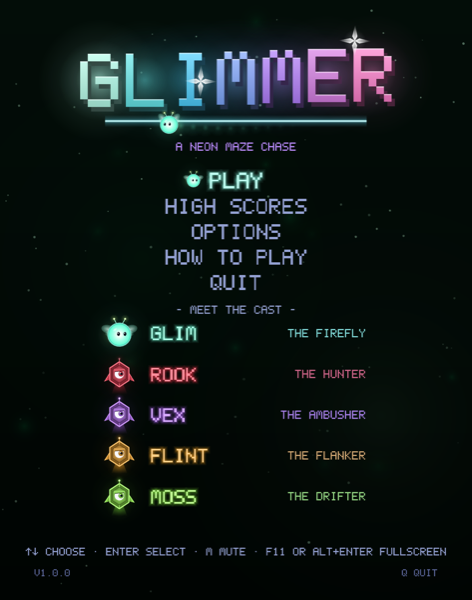
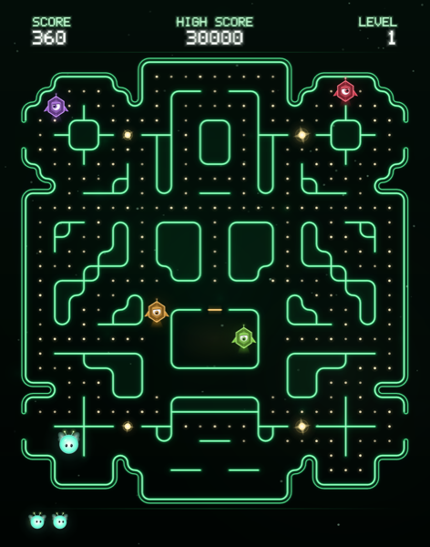

# Glimmer

A neon maze-chase arcade game I wrote in Rust.

You play as Glim, a little firefly, and the goal is to eat every glowing mote
in the maze. Four shades (together they're called the Gloom) are hunting you
the whole time. Eat one of the big flares and the tables turn for a few
seconds: the shades get scared and you can eat them for points.

<p align="center">
  
  
</p>

There are no image, font or sound files in this repo. The pixel font, the
sprites, the icon, the sound effects and the music are all generated by code
when the game starts. It doesn't use the network at all, and the release build
is a single executable of about 1.6 MB.

## Download

Get the latest version from the
[Releases page](https://github.com/abdulazizAlrashidi/glimmer/releases/latest).

**macOS** (Apple Silicon and Intel): download `glimmer-1.0.0-macos.zip`, unzip
it and move Glimmer.app to Applications. I don't have a paid Apple developer
account, so the app isn't notarized and macOS will block it the first time you
open it. After that first try, go to System Settings > Privacy & Security,
scroll down and click "Open Anyway". If you're comfortable with the terminal,
this does the same thing:

```bash
xattr -dr com.apple.quarantine /Applications/Glimmer.app
```

**Windows** (64-bit): download `glimmer-1.0.0-windows-x64.zip`, unzip it and
run `glimmer.exe`. The exe isn't signed, so SmartScreen may complain. Click
"More info" and then "Run anyway".

**Linux** (x86_64): download `glimmer-1.0.0-linux-x64.tar.gz`, extract it and
run `./glimmer`. It needs OpenGL, X11 and ALSA, which pretty much every desktop
distro already has.

You can also build it yourself, see [Building](#building) below.

## How to play

Clear the maze by eating all the motes. If a shade touches you, you lose a
life. The exception is a frightened shade: you eat it instead, and it floats
back to the nest as a glowing eye. Catch more than one during the same flare
and the points double each time.

Twice per level a relic shows up below the nest. It only stays for about nine
seconds, so grab it if the way is clear. The tunnels on the sides take you to
the other side of the maze, and shades slow down inside them.

### Controls

| Key | Action |
| --- | --- |
| Arrow keys / WASD | Move. You can press a direction a little early and Glim turns at the next corner. |
| Esc / P | Pause |
| Enter / Space | Select |
| M | Mute (a small badge shows while muted) |
| F11 or Alt+Enter | Fullscreen (Ctrl+Cmd+F also works on macOS) |
| F3 | Debug overlay that shows where each shade is aiming |
| Q | Quit from the title screen |

The menus work with the mouse too. The game pauses itself if you switch to
another window.

### Points

| | Points |
| --- | --- |
| Mote | 10 |
| Flare | 50 |
| Shades eaten during one flare | 250, 500, 1000, 2000 |
| All four during one flare | 3000 bonus |
| Relics | 150 up to 4000, depending on the level |

You get an extra life at 15,000 points. You can change that, and the number of
starting lives, in Options.

### The shades

Each one has its own way of chasing you:

- **Rook** (red) goes straight for you. It doesn't start in the nest like the
  others, and it speeds up when the maze is almost empty.
- **Vex** (purple) aims a few tiles ahead of you and tries to cut you off.
- **Flint** (orange) uses Rook's position to come at you from the other side.
- **Moss** (green) chases you from a distance but loses interest when it gets
  close.

Every so often they all back off for a few seconds and drift to their own
corners. Those breaks get shorter on later levels, and after a couple of
minutes they stop happening at all.

## What's in it

- Four mazes, each with its own colors: Firefly Garden, Crystal Caverns,
  Moonlit Loom and Ember Citadel. After the first 14 levels they keep rotating,
  and the colors change on later rounds.
- Three short animated interludes between levels.
- A demo mode on the title screen where the computer plays.
- Top 10 high scores with initials, saved on your computer. If you close the
  window in the middle of a game, your score still gets saved.
- Options for volume (master, music, effects), fullscreen, screen shake, a CRT
  scanline filter and an FPS counter.
- A four-page how-to-play screen.

## Building

You need Rust 1.88 or newer ([rustup.rs](https://rustup.rs)).

```bash
git clone https://github.com/abdulazizAlrashidi/glimmer.git
cd glimmer
cargo run --release
```

macOS and Windows don't need anything else. On Linux, install the X11, OpenGL
and ALSA development packages first. On Debian or Ubuntu:

```bash
sudo apt install libx11-dev libxi-dev libgl1-mesa-dev libasound2-dev
```

To run the tests:

```bash
cargo test
```

There are a few hundred unit tests for the maze rules, movement, the shade AI,
scoring, the audio synth, the font and the save files. There's also a soak
test that lets the built-in autopilot play every maze for a long time and
checks the game state on every tick.

### Command line options

```text
--level <N>            start new games at level N
--seed <N>             use a fixed random seed
--windowed             ignore the saved fullscreen setting
--mute                 start muted
--shot <SCENE> <OUT>   render one screen to a PNG file and exit
--shot-time <S>        scene time in seconds for --shot
-h, --help             show help
-V, --version          show the version
```

`--shot` is what I use for screenshots, for example
`glimmer --shot fright fright.png`. Run `glimmer --help` to see all the scene
names. (On Windows the release build has no console window, so `--help` won't
print anything there. Use `cargo run -- --help` instead.)

## Where your data is saved

Settings and high scores are small text files:

- macOS: `~/Library/Application Support/Glimmer/`
- Linux: `~/.local/share/glimmer/` (or `$XDG_DATA_HOME/glimmer/`)
- Windows: `%APPDATA%\Glimmer\`

If one of them gets corrupted or deleted, the game just goes back to the
defaults.

## How the code is organized

The game logic doesn't know anything about drawing or sound. It runs at a fixed
120 updates per second, and the renderer interpolates between updates so
movement stays smooth at any frame rate. The game reports what happened
(a mote was eaten, a shade was caught, and so on) as events, and the audio and
particle effects react to those. Because the logic runs fine without a window,
the tests and the demo mode can play the game headless.

| Part | Files |
| --- | --- |
| Game rules | `game.rs`, `player.rs`, `shade.rs`, `actor.rs`, `autopilot.rs` |
| Mazes and settings | `maze.rs`, `mazes.rs`, `config.rs`, `geom.rs`, `rng.rs` |
| Graphics | `render/` (walls, sprites, particles, color themes), `font.rs`, `icon.rs`, `view.rs` |
| Sound | `synth.rs` (makes every sound and song), `audio.rs` (plays them) |
| Screens and menus | `app.rs`, `app/`, `input.rs`, `save.rs` |

The only dependency is [macroquad](https://github.com/not-fl3/macroquad),
which handles the window, input and audio output.

`third_party/quad-snd` is a copy of macroquad's audio backend with one change:
smaller audio buffers on macOS, because the default ones made the sound effects
lag behind the game a bit. Details are in
[third_party/quad-snd/GLIMMER_PATCH.md](third_party/quad-snd/GLIMMER_PATCH.md).

## License

MIT, see [LICENSE](LICENSE). The libraries that get compiled into the game and
their licenses are listed in [THIRD_PARTY_NOTICES.md](THIRD_PARTY_NOTICES.md).
